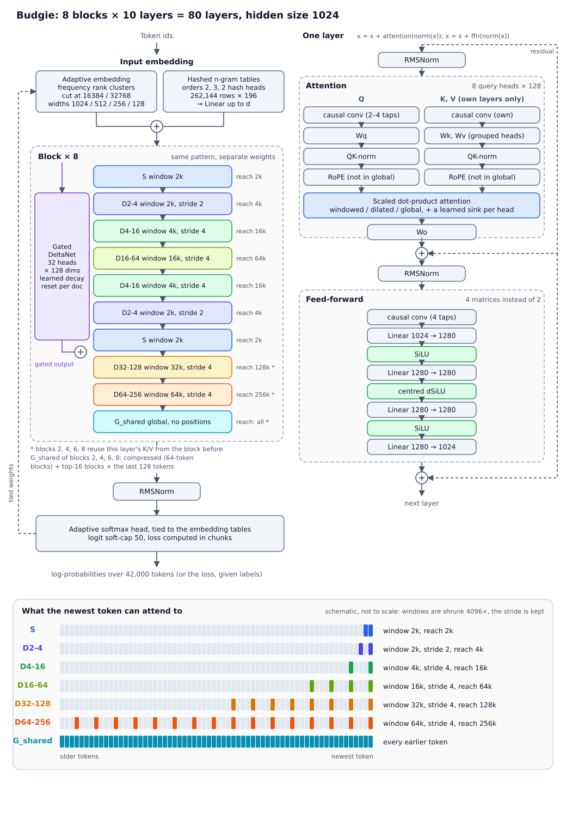

# Budgie 1

Budgie is a decoder-only language model built from **windowed, dilated and global attention layers**, with
depthwise causal convolutions in front of every attention and feed-forward block, a deeper-than-usual FFN,
hashed n-gram input embeddings and an adaptive-softmax output head. This repository holds the model code,
the tokenizer and the chat template in Hugging Face format.

**This repository is the model framework only**: modelling code, configuration, tokenizer and tests. It has no
weights, training code or data. Trained models are published on Hugging Face, in the
**Budgie1.0-1B** collection of [Hugodonotexit](https://huggingface.co/Hugodonotexit). The collection does not
exist yet; its link will be added here when it does.

The default configuration (`BudgieConfig()`) is 8 blocks of 8 layers (64 layers), hidden size 1536, 12 heads of
128 dims, **2.06 B parameters** (1.85 B with the linear branch off), vocabulary 42,000, positions up to 1M.
The model is trained by growing it one block at a time, so smaller depths matter too:

| `num_blocks` | 1 | 2 | 3 | 4 | 5 | 6 | 7 | 8 |
|---|---|---|---|---|---|---|---|---|
| parameters | 0.36 B | 0.60 B | 0.84 B | 1.08 B | 1.33 B | 1.57 B | 1.82 B | 2.06 B |



> Status: the code, tokenizer and tests are working. The layout changed on 2026-11-04 (wider and shallower, one global
> layer per block, a Gated DeltaNet branch) before the restarted training produced a checkpoint; the Budgie1.0 models
> are not published yet. Until they are, the examples below build a randomly initialised model.

## Install

```bash
git clone <this repository> budgie
cd budgie
pip install -e .            # exposes the repo root as the package `budgie`
pip install -e ".[fast]"    # optional: the causal-conv1d CUDA kernel
pip install -e ".[kernels]" # optional: Liger and xformers kernels (off until switched on, see below)
pip install -e ".[dev]"     # optional: pytest
```

Requires Python 3.10+, `torch>=2.6` and `transformers>=5.15` (developed against transformers 5.15 and
torch 2.13). Without `causal-conv1d` the model uses an equivalent PyTorch convolution, which gives the same
results; the kernel is a little faster on GPU.

### Optional fused kernels

`budgie/kernels.py` can run the RMSNorm / QK-norm and rotary embedding with Liger's Triton kernels, the embedding lookups with
Liger's embedding kernel, the loss with Liger's fused linear cross entropy (summed for training, per token for evaluation;
the vocabulary logits are never built), and the window attention through xformers' CUTLASS kernel. They are off by default and
every call site keeps its PyTorch path:

```python
from budgie import kernels
kernels.configure(liger=True, xformers=True)     # or one kernel: rms_norm, rope, loss, embedding, attention; or BUDGIE_KERNELS=liger,xformers
print(kernels.self_check(torch.device("cuda")))  # runs each enabled kernel on small tensors against PyTorch; a failing one switches itself off
```

Liger kernels the architecture has no use for (SwiGLU / GeGLU, LayerNorm, modulated RMSNorm, multi-token attention, softmax,
sparsemax, mHC, the int2 x int8 matmul) are not used. `tests/test_kernels.py` (needs a CUDA GPU) compares every kernel with the PyTorch path on the
model's own code, forward and backward.

## Use

The repository root is the model directory, laid out like a Hugging Face model repo:

```
config.json               default architecture, with auto_map for trust_remote_code
generation_config.json    stops on <eos> and on <|end|> (end of a chat turn)
configuration_budgie.py   BudgieConfig
modeling_budgie.py        BudgieModel, BudgieForCausalLM
*.py                      one module per concern (attention, ffn, embeddings, head, cache, ...)
tokenizer/                tokenizer.json, tokenizer_config.json, special_tokens_map.json, chat_template.jinja
```

The modules are flat on purpose: `trust_remote_code` copies only same-directory imports next to a
checkpoint, so a saved checkpoint is self-contained.

### Build a model

```python
import budgie                                    # registers the Auto classes
from transformers import AutoConfig, AutoModelForCausalLM

config = AutoConfig.from_pretrained(".")         # or budgie.BudgieConfig(num_blocks=4, ...)
model = AutoModelForCausalLM.from_config(config)
print(config.num_hidden_layers, sum(p.numel() for p in model.parameters()) / 1e9)
```

### Load a checkpoint

Models in the [Budgie1.0 collection](https://huggingface.co/Hugodonotexit) are checkpoint
directories: weights, `config.json`, the tokenizer and a copy of the code files, as written by `save_pretrained`.
They load anywhere, without this repository installed:

```python
from transformers import AutoModelForCausalLM, AutoTokenizer

model = AutoModelForCausalLM.from_pretrained("Hugodonotexit/<model name>", trust_remote_code=True)
tok = AutoTokenizer.from_pretrained("Hugodonotexit/<model name>")
```

`<model name>` is a model in the collection; a local checkpoint directory works the same way.

Inside this repository, the tokenizer is in a subfolder: `AutoTokenizer.from_pretrained(".", subfolder="tokenizer")`.

### Things that differ from a usual causal LM

* **`logits` are log-probabilities.** The adaptive softmax normalises over the whole vocabulary, so without
  `labels` the model returns `log_softmax` output (in token-id order), not raw logits. Pass `labels` to get
  the loss; the logits are then not materialised (`logits=None`).
* **The cache is a `BudgieCache`.** Each layer keeps only the keys a later query can still see (window ×
  dilation tokens, everything for global layers, nothing for layers that read another layer's K/V), plus the
  convolution states. `generate()` creates one for you.
* **Single-token decoding runs as a CUDA graph.** On a GPU, `decode.py` replays one captured graph per generated
  token (fixed-size ring buffers for K/V, conv and linear-branch states updated in place) instead of launching
  ~6000 small kernels, which makes decoding about 10x faster at 1k-4k tokens of context and about 7x at 16k.
  It is used for unpadded, `no_grad`, single-token steps; padded batches, beam search, `inputs_embeds` and CPU
  take the eager path, and the cache hands its state back whenever anything else needs it. Set
  `BUDGIE_FAST_DECODE=0` to turn it off.
* **`tok(text)` gives `<bos> text`.** There is no trailing `<eos>`, so a prompt can be continued as it is (the way
  Llama-style tokenizers behave); `tok(text, add_special_tokens=False)` gives the bare ids. A training document is
  `<bos> text <eos>`: append `tok.eos_token_id` yourself when you build one. For lm-evaluation-harness use
  `add_bos_token=True` (`--model_args pretrained=<model>,trust_remote_code=True,add_bos_token=True`): the model needs
  the `<bos>` that documents start with, and with it the context and continuation carry no `<eos>`. A `tokenizer.json`
  from before this change still ends every text with `<eos>`; delete the `<eos>` entries of its `post_processor`
  (`single` and `pair`) to match.
* **Documents are separated by `<bos>`.** The linear branch resets its state at every `<bos>`.

### Chat, thinking and tools

```python
msgs = [{"role": "user", "content": "What is 17 * 23?"}]

tok.apply_chat_template(msgs, add_generation_prompt=True, tokenize=False)
# <bos><|user|>\nWhat is 17 * 23?<|end|>\n<|assistant|>\n<think>\n
```

**Thinking is always on; there is no toggle.** The generation prompt opens a `<think>` block, the model writes its
reasoning, closes it with `</think>` and answers. When nothing needs working out it closes the block straight away
(`<think>\n\n</think>\n\n`), which is also how answers without reasoning are written in the training data. An
`enable_thinking` argument is ignored. The template also handles `reasoning_content`, `tools=[...]` and
`tool_calls`; see [docs/tokenizer.md](docs/tokenizer.md) for the exact format. Note that no checkpoint has been
trained on the thinking and tool tokens yet.

## Architecture in short

* **Layers.** A block is `S D4-16 D16-64 D4-16 D2-4 SUM D32-128 D64-256 G_shared`, repeated `num_blocks` times (8 by
  default → 64 layers; `SUM` is not a layer). `S` is local attention (a 2k window); the `D` layers are dilated, named by
  window and reach (`D16-64`: a 16k window at stride 4 reaching 64k back), up to `D64-256`, which reaches 256k; `G_shared` is
  global attention without positional encoding, one per block. Past 256k only the global layers and the linear branch
  see anything, which keeps long contexts cheap: at 1M tokens a global layer averages 512k keys per query and a
  windowed one at most 64k. Every layer is `x += attn(norm(x))` then `x += ffn(norm(x))`.
* **Attention.** Grouped-query, with a depthwise causal convolution on Q and another on K/V, QK-norm, rotary
  positions (not in the global layers), and a learned sink logit per head. The rotary angles are computed in fp64 and
  reduced mod 2π, so they stay exact at 1M positions. Optional for long contexts: `rope_extension` (YaRN or linear
  position stretching) and `global_logit_scale` (a log-length query scale on the global layers past the trained length). Every second block (2nd, 4th, …) reuses the
  K/V of the block before it in its `D16-64`, `D32-128`, `D64-256` and `G_shared` layers (`kv_share`), which
  cuts the KV cache; `S`, `D2-4` and `D4-16` keep their own.
* **Sparse global layers (`sparse_global`).** In every second block the global layer is compressed + selected instead
  of dense, after DeepSeek's NSA: each query sees every earlier 64-token block pooled into one key and value, the 16
  blocks that the previous 16 queries rated highest token by token, and the last 128 tokens, in one softmax. At 1M
  tokens that is ~10k keys per query instead of ~512k, and total attention cost drops to about 0.6× (0.7× at 256k);
  these layers read the dense layer's K/V before them, so the KV cache does not change. The other four global layers
  stay dense for exact lookups. Models with these layers decode on the eager path (no CUDA-graph decoding).
* **FFN.** A causal convolution, then four matrices `d → 2560 → 2560 → 2560 → d`; SiLU after the first and last hidden
  layer and a centred dSiLU after the middle one.
* **Embeddings.** A frequency-sorted adaptive embedding (the 16,384 most frequent tokens at width d, about 94% of
  text; ranks 16,384–39,999 at d/2; the last 2,000 at d/4) plus hashed 2- and 3-gram tables with two independent hash heads each, projected up to the
  hidden size. The output head is an adaptive
  softmax tied to the same tables, with logits soft-capped at 50.
* **Linear branch (on when `block_pattern` has a `SUM`).** A Gated DeltaNet branch per block (32 heads × 128) that reads
  the block's input and writes a gated term into the residual stream at the `SUM`, just before the layer that follows
  it. Its fixed-size state maps keys to values: writing a value at a key first erases what was stored there (the delta
  rule), and a learned per-token decay and write strength decide what to keep. Decays start at half-lives spread over
  1k–1M tokens. `lin_rule="retention"` gives the earlier fixed-decay branch, and a `config.json` without `lin_rule`
  loads as that. A pattern without `SUM` has no branch (no modules, and no `lin_*` keys in `config.json`).

[docs/architecture.md](docs/architecture.md) describes each part and every configuration field.

## Tests

```bash
pytest tests                # CPU only, about 40 s
```

They cover shapes and log-probabilities, causality, cached decoding against a full forward pass, `generate`,
configuration validation, `save_pretrained` → `from_pretrained` including loading in a fresh process with
`trust_remote_code`, the tokenizer, special tokens and chat template, and the Gated DeltaNet recurrence against its
token-by-token fp64 reference (`tests/test_gated_delta.py`), and the compressed + selected global layers against theirs
(`tests/test_sparse.py`, including a numerical gradient check and the chunked long-sequence path). `tests/test_decode.py` checks the
CUDA-graph decode path against the eager one and is skipped when there is no GPU.

## Repository layout

| Path | Contents |
|---|---|
| `configuration_budgie.py` | `BudgieConfig`, its validation and the derived layer tables |
| `modeling_budgie.py` | `BudgieModel`, `BudgieForCausalLM`, Auto registration |
| `attention.py`, `patterns.py`, `sdpa.py` | attention layer, local / dilated / global patterns, SDPA with sinks |
| `feedforward.py`, `activations.py`, `convolution.py` | FFN, centred dSiLU, causal convolution |
| `embeddings.py`, `head.py` | adaptive + n-gram input, adaptive-softmax head |
| `retention.py` | the linear branch: Gated DeltaNet and fixed-decay retention |
| `sparse.py` | compressed + selected global attention (`sparse_global`) |
| `cache.py` | `BudgieCache` |
| `decode.py` | the CUDA-graph decode path (ring-buffer state, captured single-token step) |
| `norms.py`, `rotary.py`, `decoder.py` | RMSNorm / QKNorm, rotary embeddings, decoder layer |
| `tokenizer/` | tokenizer and chat template |
| `config.json`, `generation_config.json` | default architecture and generation settings |
| `tests/` | pytest suite |
| `docs/` | architecture and tokenizer notes, and the structure diagram (`structure.svg`, drawn from `config.json` by `make_structure_diagram.py`) |

## Licence

The code, configuration and tokenizer in this repository are released under the
[Apache License 2.0](LICENSE) (see also [NOTICE](NOTICE)). The weights of the models in the Budgie1.0-1B
collection are published separately on Hugging Face, and each model's page states its own licence.
