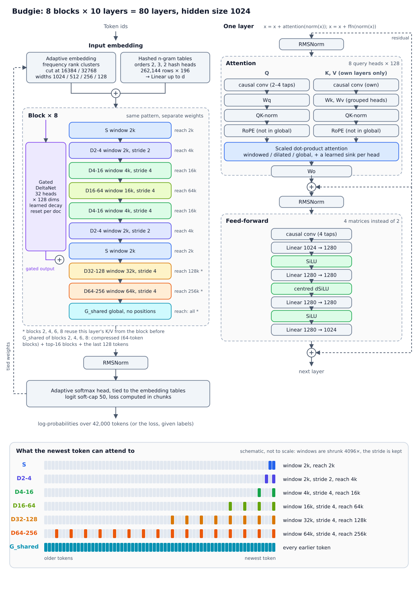

# Architecture

All numbers are the defaults of `BudgieConfig()` unless stated. Everything is configurable; see the
[configuration reference](#configuration-reference).



The diagram is generated from `config.json` by `docs/make_structure_diagram.py` (standard library only); re-run it
after changing the defaults.

## Layout of the stack

A **block** is a sequence of layer kinds, `block_pattern = (S, D4-16, D16-64, D4-16, D2-4, SUM, D32-128, D64-256,
G_shared)`, and the model is `num_blocks` blocks (8 → 64 layers; `num_hidden_layers` counts the entries other than `SUM` and cannot be
set). `SUM` is not a layer: it marks where the linear branch is added back.

| Kind | Window | Dilation | Reach | Rotary | KV heads | Conv kernel |
|---|---|---|---|---|---|---|
| `S` local | 2048 | 1 | 2k | yes | 6 | 2 |
| `D2-4` dilated | 2048 | 2 | 4k | yes | 6 | 2 |
| `D4-16` dilated | 4096 | 4 | 16k | yes | 6 | 4 |
| `D16-64` dilated | 16384 | 4 | 64k | yes | 4 | 4 |
| `D32-128` dilated | 32768 | 4 | 128k | yes | 2 | 4 |
| `D64-256` dilated | 65536 | 4 | 256k | yes | 2 | 4 |
| `G_shared` global | all | 1 | all | no | 4 | 4 |

The names give window and reach in k tokens (`D16-64`: window 16k, reach 64k). There is one global layer per block:
past 256k only the global layers and the linear branch see anything, and the cost of a long context is mostly theirs
(at 1M tokens a dense global layer averages 512k keys per query, the widest windowed layer 64k); in every second
block the global layer is compressed + selected instead (see [below](#compressed--selected-global-layers)). Up to 128k, `D32-128` and
`D64-256` both see the whole prefix at stride 4; they differ only beyond 128k. `D4-16` appears twice per block and
covers everything a 1k-window stride-4 layer would; `D2-4` gives a second, stride-2 view of the last 4k. Up to 2026-11-03 the default was 12 layers per block at hidden
size 1024, with two global kinds (`G_shared`, `G`) and the extra kinds `N`, `D1-2`, `D1-4` and `D128-256`; configurations saved then carry their own `attention_types` and load unchanged.

Rotary uses `rope_theta = 5e5`, so its slowest dimension turns once in ~2.6M tokens, beyond any rotary layer's
reach (256k).

The rotary angle `position × inv_freq` is computed in fp64 and reduced mod 2π before it is cast to fp32, 65,536
positions at a time. The rounding error of a plain fp32 product grows with the absolute position, not with the
distance q − k: the worst dimension is off by 0.008 rad at 256k and 0.031 rad at 1M, in q and k independently.
Reducing in fp64 makes the angles exact (to fp32 output rounding) at any position. fp16 cannot hold positions at all
(it is exact only up to 2,048 and overflows at 65,504).

A query at position *i* in a dilated layer sees *i, i−d, i−2d, …* (*window* tokens). Dilation is implemented
by dealing the tokens into *d* interleaved sequences, each an ordinary windowed problem, so a dilated layer
costs the same as a local one. The global layers have no positional encoding, and the whole model relies on the local layers'
rotary positions and convolutions for order. `attention_types` redefines the kinds, and `block_pattern` can use
any letters defined there.

Every layer is

```
x = x + attention(rms_norm(x))
x = x + ffn(rms_norm(x))
```

with the residual stream kept in fp32 (`fp32_residual`) and a final RMSNorm before the head.

## Attention

* Q reads a depthwise **causal convolution** of the normed input; K and V read a second one. The kernel is
  2–4 taps (per kind). The convolution runs on the whole sequence before the tokens are dealt out for dilation, so a
  dilated layer's keys each summarise `conv` consecutive tokens; with `conv` ≥ `dilation` (4 and 4 in every default
  `D` kind) the strided keys together cover every token. The global layers also use 4 taps: they have no rotary
  positions, so the convolution is their only direct signal of local order, and each key and query summarises a short
  phrase rather than one token. With `causal-conv1d` installed and on CUDA the convolution uses its kernel (wrapped as a
  `torch.library` custom op so `torch.compile` does not break on it); otherwise `F.conv1d`.
* **QK-norm**: queries and keys are RMS-normalised per head over `head_dim`, with a learned scale, before rotary.
* **Global logit scale** (`global_logit_scale`, off by default): past a trained length L, the global layers' queries
  are multiplied by ln(p + 1) / ln L at absolute position p (Scalable-Softmax), which sharpens a softmax over more keys
  than training saw. It is exactly 1 below L (1.056 at 2L, 1.111 at 4L for L = 262,144), so it changes nothing inside
  the trained length, and it is applied the same way in the ordinary forward, the chunked long-sequence path and
  graph-replayed decoding. `BudgieModel.set_global_logit_scale` sets it on a built model.
* **Sinks**: one learned logit per head acts as an extra softmax slot with a zero value, so a head can attend to
  "nothing". On CUDA the sink is merged with the memory-efficient kernel's own sliding-window mode; elsewhere it
  is an extra key column.
* **Grouped-query attention**: `kv_heads` per kind. K/V are expanded to the full head count before SDPA
  (`enable_gqa` falls back to the slow math kernel on some GPUs).
* **KV sharing** (`kv_share`): a map from a *reader* layer to an earlier *owner* layer of the same kind. A reader
  keeps its own Q projection, output projection and FFN, and has no K/V projection, K/V convolution, K/V norm or
  cache. The default makes every second block read the previous block's K/V in the kinds of `SHARED_KINDS`
  (`D16-64`, `D32-128`, `D64-256`, `G_shared`); other kinds, here `S`, `D2-4` and `D4-16`, keep their own. With
  the default layout that is 4 of the 8 global layers holding K/V. `{}` turns it off.

## Compressed + selected global layers

`sparse_global = {"every": 2, "compress": 64, "select": 16, "group": 16, "local": 128}` (None = off) makes the global
layers of every `every`-th block (2nd, 4th, …, the layers that already read the previous block's K/V) compressed +
selected instead of dense, after DeepSeek's NSA. A query at position *t*, in query group *G* = ⌊*t* / `group`⌋, attends
in **one softmax** (with the sink) over:

* **compressed**: every block of `compress` keys that ends before its group starts, pooled into one key and one
  value. The pooling weights are a softmax over the block of *k* · `pool_score[h]` (one learned vector per K/V head,
  zero at the start = the mean); the pooled key is rescaled to the weighted mean RMS of the keys it pools, so it scores
  on the same scale as a single key;
* **selected**: every key of the `select` blocks with the highest score, where a block's score is the softmax over
  the compressed blocks summed over all heads and over the queries of the **previous** group. Only blocks that end
  before the local window are candidates;
* **local**: the last `local` tokens up to and including *t*.

Selection is made by earlier queries only, so the layer is causal and cached decoding reproduces a full forward
exactly. The selection needs no extra loss: the compressed attention is trained by the language-model loss, and the
blocks it attends to are what gets selected (top-k itself has no gradient). Per query that is *t*/64 + 1024 + 144
keys, ~17k at 1M versus ~512k for a dense global layer. Scores are materialized a bounded number of query groups at a
time (`sparse.BUDGET`), checkpointed when grad is on, so no custom kernel is needed; at short lengths (1–4k) such a
layer costs about as much as a dense one. The long-sequence mode pools K/V once per sequence and computes the 16
queries before each chunk for its first selection. The decode cache keeps each layer's selection state
(`BudgieCache.sparse_state`); models with these layers decode on the eager path, not through CUDA graphs. `sparse.py`
holds the code; `tests/test_sparse.py` checks it against a token-by-token fp64 reference. A config.json written
before `sparse_global` existed loads with it off.

## Feed-forward

A depthwise causal convolution (`ffn_conv_kernel`), then `n + 1` bias-free linear layers
`d → w₁ → … → wₙ → d`, where `intermediate_size = [w₁ … wₙ]`. The default `[2560, 2560, 2560]` at `d = 1536`
gives four matrices. Activations: SiLU after each hidden layer except the middle one (`n // 2`), which uses the
**centred dSiLU**: the derivative of SiLU, shifted so that it is exactly 0 at 0 (its zero crossing at x ≈ −1.278 is
moved to the origin). Its range is (−0.0998, 1.0998).

`intermediate_size` may also be a list of such lists (one per block, or one per layer) to vary the FFN with depth.

## Embeddings and output

* **Adaptive input.** Token ids are mapped to a frequency rank by the buffer `embed.rank_of`, then embedded by
  cluster at the cutoffs `adaptive_cutoffs` (16384, 40000), each cluster `adaptive_div` (2) times narrower than the
  one before: ranks below 16384 get width *d*, ranks 16384–39999 *d/2*, the last 2000 *d/4*, the narrower ones
  projected up by a Linear. The first cluster holds about
  94% of the tokens in text, so only rare tokens use the narrow table. **`rank_of` is the identity until `model.model.embed.set_vocab_order(order)` is called** (with the
  token ids sorted most frequent first); trained checkpoints carry it. It has to match the tokenizer and the data
  the model was trained on.
* **Hashed n-grams.** For each order in `ngram_orders` (2, 3) the previous n tokens are hashed by `ngram_heads` (2)
  independent hash functions, each owning its slice of a table of `ngram_buckets` (262,144) narrow rows
  (`ngram_dim` = 128). The heads' rows are concatenated and projected up to *d*. This is added to the token
  embedding. The cache keeps the last `max(order) − 1` ids so decoding matches a full forward.
* **Output head.** An adaptive softmax tied to the input tables: the first cluster's tokens are scored against its
  embedding rows plus one logit per tail cluster (`head.cluster_vectors`), and tail tokens are scored inside their
  cluster through the same projection used on the input side. Logits are soft-capped at `logit_softcap` (50).
  `adaptive_cutoffs=[]` gives an ordinary tied full softmax. The loss is computed in checkpointed chunks of 2048
  tokens, so full-vocabulary logits are never materialised for a whole batch.

## Linear branch

With a `SUM` in `block_pattern`, each block has one linear-attention branch that reads the residual stream at the start
of the block (own RMSNorm and causal convolution), runs in parallel with the block's local layers and adds a gated
output at the `SUM`, just before the layer that follows it (`SUM` is not a layer). Each branch has `lin_heads` (32)
heads of `lin_head_dim` (128), `q` and `k` are L2-normalised, and every head keeps a `dk × dv` state in fp32 that is
reset at every `<bos>`. `lin_rule` picks the state update.

**`"gated_delta"` (default): Gated DeltaNet** (Yang, Kautz and Hatamizadeh, 2025). Per head and token:

```
S_t = α_t (I − β_t k_t k_tᵀ) S_{t−1} + β_t k_t v_tᵀ    =  α_t S_{t−1} + β_t k_t (v_t − α_t S_{t−1}ᵀ k_t)ᵀ
o_t = q_tᵀ S_t
α_t = exp(−λ_t),   λ_t = λ_h · softplus(a_t + dt_bias_h) / ln 2,   a_t = a_proj(u_t)
β_t = sigmoid(b_proj(u_t))
```

Writing `v_t` at key `k_t` first removes what the state already returns for `k_t` (the delta rule), so a new value
replaces the old one at that key instead of piling on top of it; that, not the decay, is what keeps a fixed-size state
from blurring over long contexts. `β_t` is how strongly a token is written and `α_t` how much of the state survives it,
both learned per token. `λ_h = ln 2 / half_life` is the head's starting decay: half-lives are spread log-uniformly
over `lin_half_life_range` (1024 … 1,048,576 tokens) and staggered from block to block; `a_proj` and `dt_bias` start at
zero, so every head starts exactly at its half-life and learns to shorten or lengthen it. With |k| = 1 and β ≤ 1 each
step is a contraction plus a bounded write, so the state needs no normalisation.

`gated_delta_chunked` evaluates this `lin_chunk` (128) tokens at a time in the WY form: within a chunk the writes solve
one unit lower-triangular system per head (`torch.linalg.solve_triangular`), everything that does not depend on the
incoming state is computed for all chunks at once, and only `S ← M S + N` (a `dk × dk` by `dk × dv` product per
chunk) runs chunk after chunk. Cost and memory per chunk grow with `lin_chunk²`. `gated_delta_reference` is the
token-by-token fp64 oracle.

**`"retention"`: fixed-decay retention** (RetNet-style), the branch before 2026-11-04. Per head, with a fixed decay
`γ = exp(−ln 2 / half_life)`:

```
S_t = γ S_{t−1} + (1 − γ) k_t v_tᵀ
o_t = q_tᵀ S_t / (1 − γ^n)                n = tokens since the document start
```

A `config.json` with a branch but no `lin_rule` key was written before the field existed and loads as `"retention"`.

Both rules then RMS-normalise each head's output with a learned gain, multiply it by a per-token per-head sigmoid if
`lin_head_gate`, project it back to *d* and scale it by a learned vector `g` (initially `lin_gate_init = 0.05`).
Without a `SUM` the model has no branch modules and `config.json` carries no `lin_*` keys. A `config.json` from before
`SUM` (with `linear_branch`) loads as `"before_G"` = a `SUM` before the first `G`, anything else = no branch.

## Cache

`BudgieCache` holds, per layer, the keys and values that a later query can still see (`(window − 1) · dilation`
past tokens; everything for a global layer; nothing for a KV-sharing reader) and the states of the causal convolutions (Q, FFN,
K/V, and the branch's). The linear branch's fp32 state lives in the layer that follows the block's `SUM`; `last_doc_pos` tracks
the position within the current document. A `BudgieCache` is created automatically; a generic `DynamicCache` is not
accepted.

## Configuration reference

| Field | Default | Meaning |
|---|---|---|
| `vocab_size` | 42000 | must match the tokenizer |
| `hidden_size` | 1536 | *d* |
| `block_pattern` | `S D4-16 D16-64 D4-16 D2-4 SUM D32-128 D64-256 G_shared` | layer kinds of one block, plus at most one `SUM` (the linear branch; not last) |
| `num_blocks` | 8 | blocks in the stack |
| `attention_types` | see above | per kind: `window`, `dilation`, `conv`, `rope`, `kv_heads` |
| `num_attention_heads`, `head_dim` | 12, 128 | `kv_heads` of every kind must divide the head count |
| `kv_share` | every 2nd block reads the one before | reader layer → owner layer |
| `qk_norm`, `attention_sinks` | true, true | |
| `intermediate_size` | `[2560, 2560, 2560]` | FFN hidden widths (int, list, or list of lists) |
| `ffn_hidden_layers` | 3 | used when `intermediate_size` is an int |
| `ffn_conv_kernel` | 4 | |
| `ngram_orders`, `ngram_buckets`, `ngram_dim`, `ngram_heads` | (2, 3), 262144, 128, 2 | hashed n-gram input (`ngram_dim=None` = d/8) |
| `adaptive_cutoffs`, `adaptive_div` | (16384, 40000), 2 | frequency clusters and width ratio; `[]` = full softmax |
| `logit_softcap` | 50.0 | 0/None disables |
| `lin_rule` | `"gated_delta"` | branch state update: `"gated_delta"` (Gated DeltaNet) or `"retention"` (fixed decay); `"retention"` when a `config.json` with a branch has no such key |
| `lin_heads`, `lin_head_dim`, `lin_conv_kernel`, `lin_chunk` | 32, 128, 4, 128 | branch shape (`lin_chunk` 128: the least memory and time per token for Gated DeltaNet; chunk-terms memory grows with it) |
| `lin_base_heads` | none | set when a trained branch was widened: its first `lin_base_heads` heads keep their original half-lives and the other heads take the positions in between (`retention.branch_half_lives`). Omitted from `config.json` when none |
| `lin_half_life_range`, `lin_gate_init`, `lin_head_gate` | (1024, 1048576), 0.05, true | branch half-lives (the starting decays for `"gated_delta"`, fixed for `"retention"`) and gating |
| `rms_norm_eps`, `rope_theta` | 1e-5, 500000 | |
| `max_position_embeddings` | 1048576 | not enforced; rotary has no table |
| `rope_extension` | none | `{"type": "yarn" or "linear", "factor": s, ...}` stretches the rotary positions for a longer context (`rotary.py`); stage 11 uses YaRN ×4 from 256k |
| `sparse_global` | `{"every": 2, "compress": 64, "select": 16, "group": 16, "local": 128}` | compressed + selected global layers in every `every`-th block ([above](#compressed--selected-global-layers)); `None` = all dense |
| `global_logit_scale` | none | `{"type": "log", "trained_length": L}`: the global layers' queries × max(1, ln(p + 1) / ln L) at position p (Scalable-Softmax); exactly 1 below L |
| `fp32_residual` | true | residual stream in fp32 |
| `initializer_range` | 0.025 | |
| `tie_word_embeddings` | true | the head always reuses the input tables |

Invalid combinations (unknown layer kinds, heads not divisible by `kv_heads`, unsorted `adaptive_cutoffs`, a
`kv_share` owner that is not an earlier layer of the same kind, …) raise `ValueError` at construction.
